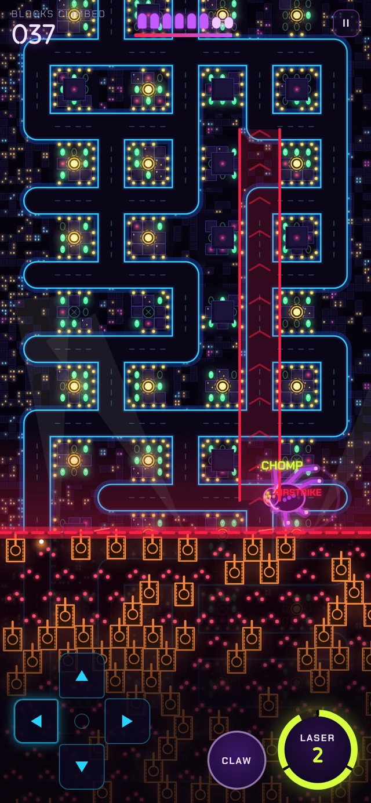

# Kaiju Surfer

A mobile-first HTML5 prototype. You steer a purple multi-armed kaiju up an endless city maze, pluck energy as you go, eat the army, and outrun the wave.

Open `index.html` in a browser; there's no build step. On a phone, steer with the D-pad (or tap and swipe) and use the Claw and Laser buttons. On desktop, use the arrow keys or WASD to steer, Space for the laser, X for the claw and P to pause.

See [DESIGN.md](DESIGN.md) for the full game design.
